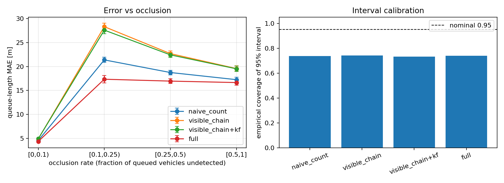

# occlusion-aware-queue-estimation

**Occlusion-aware, lane-level queue and max-pressure estimation from oblique roadside cameras.**

Adaptive signal controllers (max-pressure, fuzzy, RL) assume that per-lane queue lengths are
*given*. With a real camera they are not: trucks hide the cars behind them, far lanes merge into
blobs, and naive "count the boxes" estimates under-report exactly when congestion is worst.
This package turns the output of any off-the-shelf detector + tracker (e.g. YOLO + ByteTrack)
into **queue length, vehicle count, uncertainty and a confidence score per lane at 1 Hz**,
reasoning explicitly about what the camera *cannot* see.

No detector is trained. The contribution is the estimation layer between perception and control.

```mermaid
flowchart LR
    A[Camera frames] --> B[Detector + tracker<br/>YOLO / ByteTrack]
    B --> C[Ground-plane localisation<br/>homography]
    C --> D[Track kinematics<br/>stopped / moving, ghosts]
    D --> E[Occlusion model<br/>ray casting vs. vehicle volumes]
    E --> F[Queue observer<br/>chain + hidden-gap + tail]
    F --> G[Kalman filter<br/>length and count]
    G --> H["LaneEstimate<br/>length, count, CI95, confidence"]
    H --> I[Pressure / fuzzy inputs<br/>signal controller]
```



## Method

**Localisation.** The bottom-centre of each bounding box is mapped to metric road-plane
coordinates with a homography estimated by the normalised DLT from >= 4 image/ground
correspondences. Lanes are defined in the same frame; a point has lane coordinates
`(s, l)` (distance upstream of the stop line, lateral offset).

**Stopped vehicles.** A sliding-window least-squares velocity feeds a hysteretic state machine
(`v_stop` < `v_go`). Stopped state survives missed detections.

**Occlusion model.** Given the camera position `C` and the volumes of all known vehicles
(class-prior dimensions), a probe point `p(s)` on the lane centre line at 0.9 m height is
*hidden* iff the segment `C -> p(s)` intersects another vehicle's box (slab test). This yields a
per-lane hidden mask over `s`, with no learned component.

**Queue observation.** Walking upstream from the stop line over stopped vehicles:

1. neighbours with bumper gap <= `gap_max` are chained;
2. a larger gap is *bridged* only if it contains no visible empty stretch longer than `gap_max`
   and contains hidden road able to hold vehicles; `floor(run/pitch + 0.4)` vehicles are inferred
   per hidden run, otherwise the queue ends;
3. the contiguous hidden stretch `U` behind the last member extends the estimate by
   `pU/2` with variance `U^2 (p/3 - p^2/4)` (continuation probability `p`, uniform extent);
4. if nothing is stopped and the stop-line area is hidden, **no measurement** is produced
   (an empty lane is not confused with an unobservable one).

**Ghost vehicles.** A stopped vehicle that disappears is retained for up to `ghost_ttl_s` *only
while its location is geometrically hidden*; tracker ID switches are re-linked to ghosts.

**Filtering.** A constant-velocity Kalman filter with innovation gating fuses observations of
length and count, propagates uncertainty through unobservable periods, and yields a 95% interval and
a [0, 1] confidence combining posterior precision and visible fraction.

## Interface to signal control

```python
from oaqe import QueueEstimationPipeline, MovementSpec, PressureEstimator, to_fuzzy_inputs

pipe = QueueEstimationPipeline.from_site_config(site)           # per camera
estimates = {e.lane_id: e for e in pipe.process_frame(t, detections)}   # 1 Hz output

pressure = PressureEstimator([MovementSpec("NS", "L0", ("L7",), (1.0,))], site.lanes)
for p in pressure.compute(estimates):       # w = n_up - sum(r_k n_down_k), with std
    ...
inputs = to_fuzzy_inputs(estimates["L0"], site.lanes[0])
# {'queue_norm', 'queue_m', 'confidence', 'std_norm', 'spillback_risk'}  -> membership functions
```

A downstream exit link is monitored by instantiating a lane whose stop point is the far end of
that link; its occupancy drives `spillback_risk`. The `confidence` output lets a fuzzy rule base
down-weight lanes the camera cannot see.

## Installation (Ubuntu / WSL2)

```bash
python3 -m venv .venv && source .venv/bin/activate
pip install -e ".[dev]"            # core + tests
pip install -e ".[video]"          # optional: ultralytics + OpenCV for real video
pip install -e ".[sumo]"           # optional: SUMO / TraCI bridge
pytest
```

## Usage

```bash
# Real video (detector + ByteTrack + estimator) -> CSV
oaqe-video --config configs/site_template.yaml --video traffic.mp4 --weights yolov8n.pt

# SUMO co-simulation: vehicles -> synthetic camera -> estimator, logged next to SUMO halting counts
oaqe-sumo --sumocfg net.sumocfg --lanes edge_0 edge_1 edge_2 --camera-height 6

# Reproduce the benchmark below
oaqe-benchmark --seeds 3 --duration 400 --jobs 4 --out results/benchmark
```

The repository ships a minimal SUMO scenario in `examples/sumo/` (two-lane approach with a
fixed-time light, cars and trucks). To use your own network, copy its `.net.xml` next to a
`.sumocfg` and pass the approach lane IDs (camera-near lane first).

Site calibration (`configs/site_template.yaml`): camera position, >= 4 pixel/ground
correspondences (lane markings, survey, or orthophoto), and lane geometry.

## Evaluation protocol

A synthetic renderer (`oaqe.sim.synthetic`) produces detector-like output with exact ground truth:
IDM car-following traffic behind a fixed-time signal; a pinhole camera; per-vehicle visibility by
ray casting against all other vehicles; boxes of the *visible* parts; a visibility-dependent,
temporally correlated miss process; tracker ID switches; calibration noise (1 px) and camera
position noise (0.3 m). Scenarios vary camera height (10 / 6 / 4 m, lower = heavier occlusion)
and truck share (5% / 30%) over three lanes; the camera is beside the road, so far lanes are
occluded by near ones. All variants see the *same* detection stream (paired comparison).

Ground truth: chain of vehicles with speed < 1 m/s starting at the stop line with bumper gaps
<= 8 m. Metrics: queue-length MAE / RMSE / bias, count MAE, empirical coverage of the 95%
interval, lane-ranking agreement (top-1) and relative regret of a max-count choice, and MAE
stratified by **occlusion rate** (fraction of queued vehicles with no detection in the last 0.6 s).
Confidence intervals are percentile bootstraps over scenarios (n = 18); the first 60 s are
excluded. Estimator defaults were set on separate development seeds (>= 1001); reported seeds
are 0-2.

## Results (synthetic benchmark, 18 scenarios, 18,360 ticks per variant)

| variant | MAE [95% CI] (m) | bias (m) | count MAE | lane top-1 | regret |
|---|---|---|---|---|---|
| naive_count | 5.22 [4.53, 5.99] | -1.16 | 0.64 | 0.778 | 0.105 |
| visible_chain | 4.48 [3.69, 5.33] | -2.84 | 0.58 | 0.715 | 0.141 |
| full | 4.63 [4.01, 5.35] | -0.63 | 0.61 | 0.777 | 0.108 |

MAE (m) by occlusion rate:

| variant | [0, 0.1) | [0.1, 0.25) | [0.25, 0.5) | [0.5, 1] |
|---|---|---|---|---|
| naive_count | 4.57 | 21.38 | 18.75 | 17.26 |
| visible_chain | 4.88 | 28.31 | 22.69 | 19.57 |
| full | 4.36 | 17.35 | 16.96 | 16.65 |



Full tables, ablations and the run manifest: [`docs/benchmark/`](docs/benchmark).

**Reading the results honestly.**

- Over *all* ticks the full estimator and the visible-chain baseline are statistically
  indistinguishable in MAE (paired difference CI includes 0): most ticks are lightly occluded and
  there the inference adds little.
- Where it matters, occlusion-aware inference helps: under occlusion the error is 15-39% lower
  than the visible-chain baseline, the systematic under-estimation drops from -2.8 m to -0.6 m, and
  lane-ranking decisions improve (top-1 0.715 -> 0.777, regret 0.141 -> 0.108).
- Gap inference is the dominant component; ghosts and the tail model give small gains within
  the noise; the Kalman filter mainly buys uncertainty propagation rather than lower MAE.
- Intervals are **under-dispersed** (coverage about 0.74 against a nominal 0.95). Errors are
  heavy-tailed when most of a queue is invisible. Treat `confidence` as a relative signal until a
  site-specific calibration is done.
- Errors under heavy occlusion remain large (about 17 m MAE). This is a hard regime, not a solved one.

## SUMO co-simulation check

`oaqe-sumo` reads vehicles from a running SUMO simulation through TraCI, renders them through the
synthetic camera, and logs estimates next to SUMO's own queue statistics. One run on
`examples/sumo` (two lanes, 6,000 s, camera height 7 m, single seed, first 120 s excluded,
4,560 lane-ticks):

| lane | queue MAE (m) | bias (m) | count MAE | 95% interval coverage | corr(count, SUMO halting) |
|---|---|---|---|---|---|
| app_E_0 | 1.89 | +0.53 | 0.26 | 0.87 | 0.85 |
| app_E_1 | 3.13 | -0.67 | 0.39 | 0.74 | 0.84 |

This is a single-seed integration check on a lightly occluded two-lane scene, not a benchmark.

## Limitations and scope

- Quantitative results are **simulation-based**. The synthetic renderer is a controlled stand-in for
  detector behaviour, not a substitute for field validation; the real-video path
  (`oaqe-video`) is provided but not yet benchmarked against labelled footage.
- Localisation assumes a flat road plane and a bounding-box bottom that touches the road. When
  the lower part of a vehicle is occluded the footprint is biased upstream (not corrected).
- Lanes of one approach must be parallel; the camera position must be known (measured or PnP).
- The SUMO bridge (`oaqe-sumo`) is an integration utility, validated by the single run above and not covered by the automated tests.

## Repository layout

```
src/oaqe/
  geometry.py      homography (DLT), ray/box tests
  occlusion.py     hidden-road model on the lane centre line
  kinematics.py    per-track velocity and stopped state
  queue_model.py   observation: chain, hidden gaps, tail; reference ground truth
  filtering.py     gated constant-velocity Kalman filter
  pipeline.py      tracks, ghosts, per-tick lane estimates
  pressure.py      max-pressure and fuzzy-controller inputs
  detection.py     YOLO + ByteTrack adapter (optional)
  sim/             synthetic scene + renderer, SUMO bridge
examples/sumo/   minimal SUMO scenario (net, routes, signal program)
  evaluation/      metrics, bootstrap statistics, benchmark runner
tests/             geometry, occlusion, queue model, pipeline
```

## Roadmap

Labelled real-footage validation, interval recalibration, bottom-occlusion-aware localisation
(full camera model), closed-loop evaluation of signal controllers fed with estimated queues.

## License

MIT. See [LICENSE](LICENSE).
